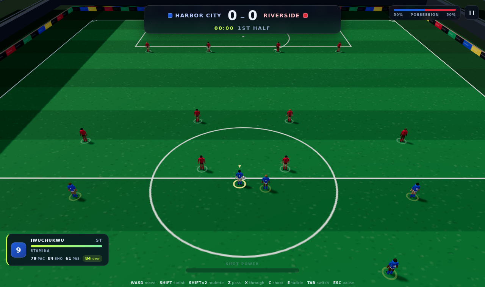
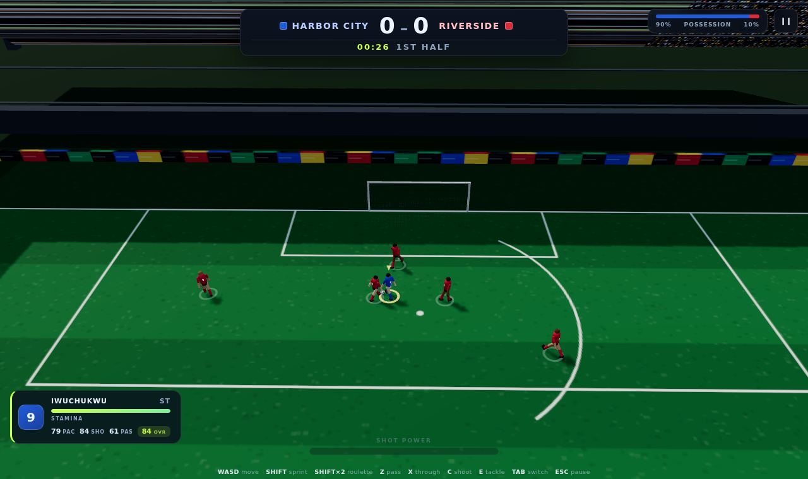
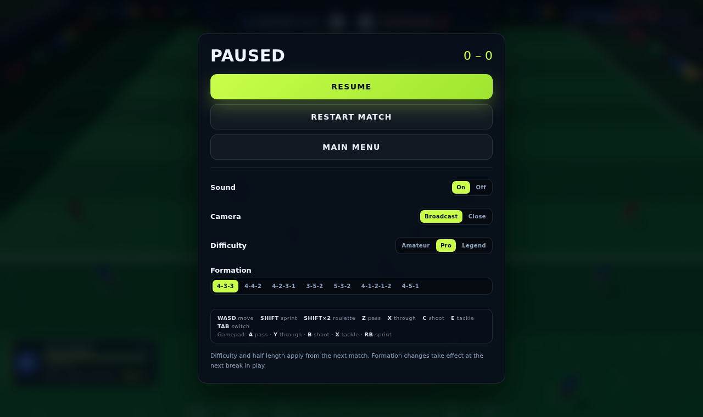
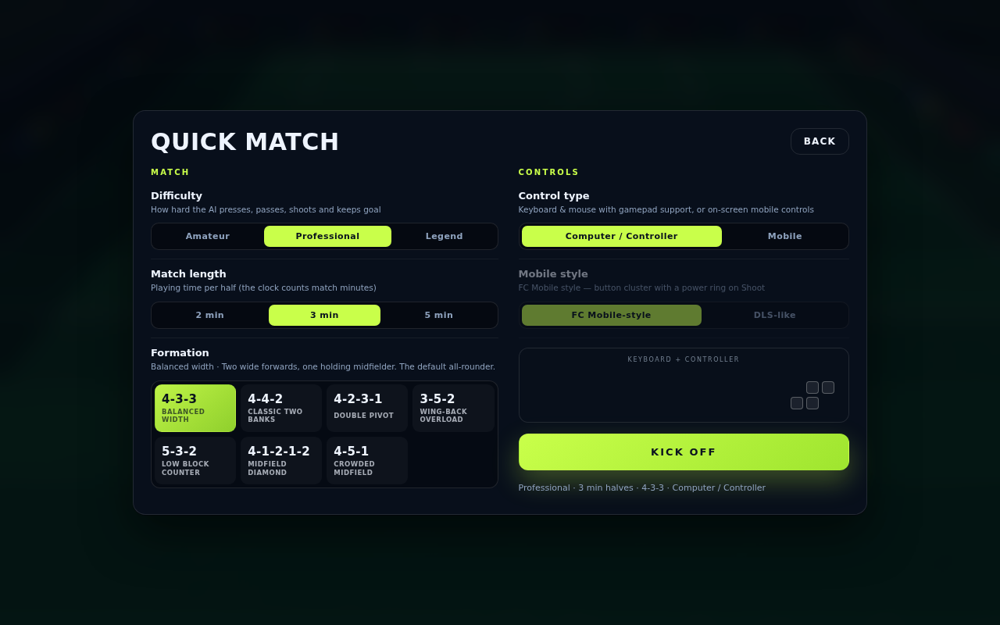
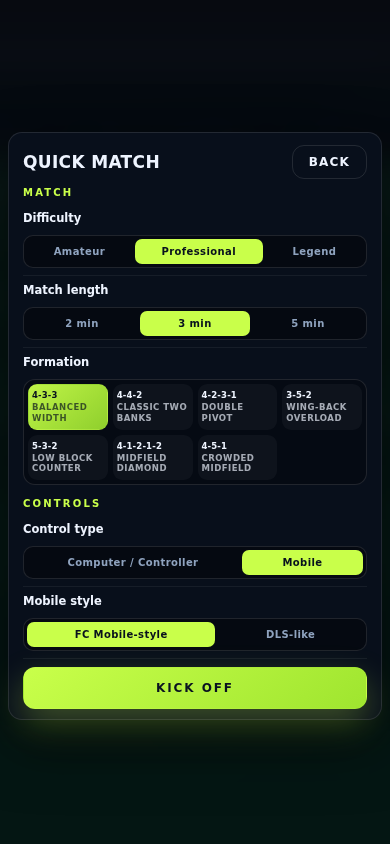
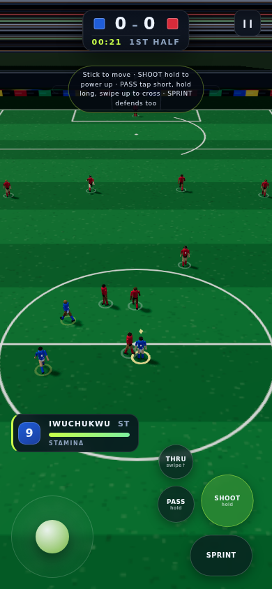
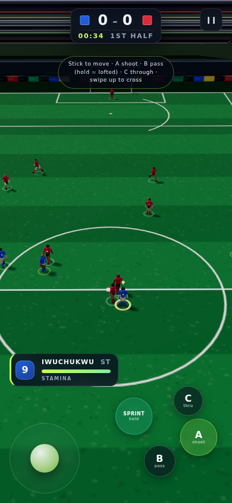
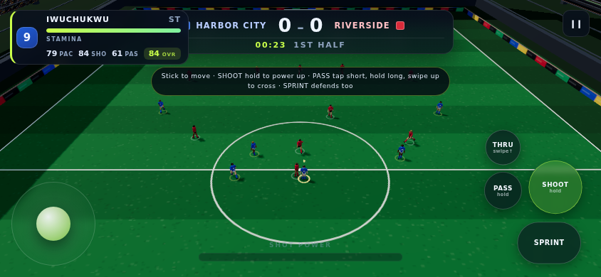
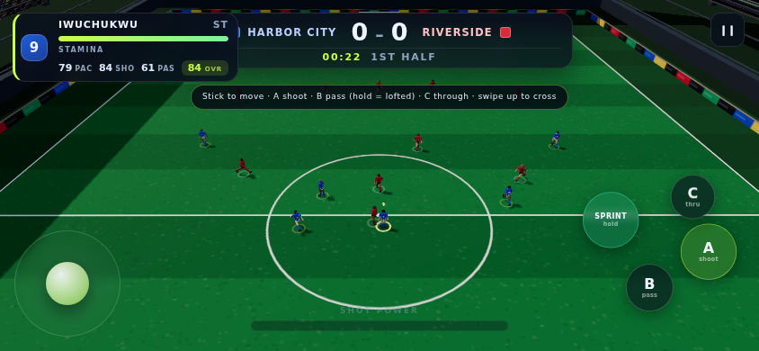

# Touchline Vale

An original, fully playable **3D eleven-a-side football game** that runs in the browser.
Built with **JavaScript + Vite + Three.js**, with every model, texture, sound and menu
generated procedurally at runtime — no external or copyrighted assets are used anywhere.

> **Name check:** the game was briefly called *Pitch Legends*, which collided with an unrelated
> existing card-battle game of the same name. It is now **Touchline Vale**, and the Android
> package id changed with it (`com.touchlinevale.game`), so install it fresh rather than over
> the old build.
>
> Touchline Vale is an independent game. It is not affiliated with, endorsed by, or based on
> any real league, club, footballer, or football-game franchise.

[](../../releases/latest)
[](LICENSE)

---

## Quick start

```bash
cd touchline-vale
npm install          # installs three + vite (dev)
npm run dev          # start the dev server
```

Then open the URL Vite prints (default **http://localhost:5173**). Click **Quick Match**.

Other scripts:

```bash
npm run build            # production build into dist/
npm run preview          # serve the production build
npm test                 # headless smoke test (Playwright) — see "Testing"
npm run desktop          # run the game in its own desktop window (Electron)
npm run desktop:package  # build standalone executables into release/
```

Requires a desktop browser with WebGL 2 (Chrome, Edge, Firefox, Safari 16+).
`npm install` needs Node 18+ (Node 22+ for the desktop build).

### Desktop / standalone executable

The game also ships as a self-contained desktop app — no browser, no server:

| File | What it is |
| --- | --- |
| `release/Touchline Vale-win32-x64.7z` | Windows x64 build (~98 MB). Extract, then run `Touchline Vale.exe`. Windows 11 opens `.7z` natively; on Windows 10 use 7-Zip or WinRAR. |

Build your own for any platform Electron supports:

```bash
npm install
npm run desktop:package          # win32 + linux, x64 → release/
npm run desktop:win              # Windows only
npm run desktop                  # launch the desktop shell from source
```

The packaged app loads the Vite build from an asar archive over `file://`, so it needs no
network connection. `npm run desktop` uses `desktop/main.cjs` (menu, window, icon in
`desktop/icon.*`), and `tests/desktop.mjs` boots the packaged binary under Playwright to
verify it — see Testing.

---

## Screenshots

| | |
| --- | --- |
|  |  |
|  |  |

Mobile and setup screens:

| | | |
| --- | --- | --- |
|  |  |
|  |  |
|  |  |

Also in `docs/`: `mobile-throwin.png` (the THROW / RECEIVER buttons during a throw-in),
`close-camera.png` (the alternative camera), `mobile.png` (portrait phone layout) and
`desktop.png` / `desktop-match.png` / `desktop-pad.png` (the packaged desktop app, the last
one showing the controller focus ring on the pause menu).

---

## Playing

You control **one** outfielder on **Harbor City**; the other 21 players (including both
goalkeepers) are driven by AI. Your team attacks the far end of the pitch — the broadcast
camera sits behind your goal and follows the play.

### Controls

| Keyboard | Action |
| --- | --- |
| `W` `A` `S` `D` / Arrow keys | Move the controlled player (camera-relative) |
| `Shift` (hold) | Sprint — drains stamina, refills when you slow down |
| `Shift` `Shift` (double-tap) | **Roulette** — 360° spin that keeps the ball at your feet and shields it from challenges |
| `Z` | Pass — aim assist picks the teammate you are pointing at (see below) |
| `X` | Through / lob pass into the space ahead of a runner |
| `C` (hold, release) | Charge a shot — the longer the hold, the harder (and less accurate) the strike |
| `E` | Tackle / challenge for the ball (works from any angle) |
| `Tab` | Switch to the next teammate |
| `Esc` / `P` | Pause and resume |

`J`, `K` and `Space` still work as legacy aliases for pass, through ball and shoot.

**Gamepad** — any controller that uses the standard mapping. Press a button to connect;
the pause menu and How-to-Play list the bindings.

| Controller | Action |
| --- | --- |
| Left stick / D-pad | Move |
| Right stick | Aim passes and shots independently of movement |
| `A` | Pass |
| `Y` | Through ball |
| `B` (hold, release) | Charge a shot |
| `X` | Tackle |
| `RB` / `RT` / `LT` | Sprint — double-tap for the roulette |
| `LB` | Switch player |
| `Back` / `Start` | Pause and resume |

The controller is not limited to the pitch: on the title screen a focus ring highlights the
current button (**D-pad** or left stick to move, **A** to select, **B** to go back, **Start**
to kick off), and the same works in the settings, squad, pause and post-match screens. A
toast confirms when a pad connects or drops out.

### Mobile controls

Pick **Mobile** in the Quick Match menu (the choice is remembered) and choose one of two
ergonomic pads. Both are multitouch, sit inside the safe area and never cover the top HUD.

**FC-style** — floating stick bottom-left, big SPRINT bottom-right, SHOOT above it, PASS to
the left of SHOOT, THRU above PASS. Every button relabels itself with its current job.

| Button | In possession | Out of possession | Throw-in |
| --- | --- | --- | --- |
| SHOOT | tap to finish, hold to charge (power ring) | slide tackle | long throw |
| PASS | tap = short pass, hold = long ball, swipe up = lofted cross | switch to nearest defender | **THROW** |
| THRU | through ball, hold or swipe up = lofted through/cross | second-man press, swipe up = keeper rush | **RECEIVER** |
| SPRINT | sprint (double-tap = roulette) | chase the carrier and auto-tackle | — |

**DLS-like** — the same stick plus a clean A / B / C cluster and a separate prominent SPRINT:
A shoots or hard-passes (charge and release), B passes (tap short, hold lofted) or holds to
contain, C plays the through ball or switches/second-man press. Swipe up on B/C rushes the
keeper, swipe down on A is a slide tackle. Short diagonal wobbles are ignored, and a brief
gesture hint appears the first time each pad is used.

Throw-ins: while your team takes one, the pad swaps to THROW / RECEIVER — the stick aims,
RECEIVER cycles the eligible team-mates (the chosen one gets a highlight ring on the pitch),
and THROW releases the ball. The normal pass/through actions cannot fire during a throw-in.

A device with no touchscreen at all (Android TV, a desktop browser, a Chromebook in laptop
mode) starts on **Computer / Controller** and the Mobile option is shown as unavailable, so the
menu never promises a pad that cannot be pressed.

**Auto tackle (every input type).** Holding Sprint without the ball makes the controlled
player chase the carrier; once he is in range and goal-side he attempts a normal tackle
automatically, with a cooldown, and never while your own team has possession. Manual
tackles (E / X / SLIDE) keep working.

### Aim assist, first touch and duels

* **Aiming.** Passes and shots follow the direction you are pointing — the movement
  direction on keyboard/touch, or the right stick on a pad. The assist only chooses the
  best *teammate inside your cone of intent*, so a pass never flies to the opposite flank.
  With nobody in the cone the ball is played into the space you are facing.
* **Shot assist.** Shots are pulled toward the far corner and the spread tightens the
  closer your aim is to goal (a rushed, power-heavy shot still sprays). Aiming away from
  goal gives a straight, directional strike instead.
* **First touch.** A player meeting a moving ball cushions it into control instead of
  letting it ping off their body. Clean traps depend on the receiver's passing attribute,
  body shape and ball speed; a poor touch leaves the ball two or three metres away, still
  in play.
* **Tackling.** Challenges are made in the direction you are running (or facing when
  standing), so diagonal and side-on tackles land. The defender steps into the duel, and
  an angled challenge is slightly less likely to win the ball than a clean head-on one.

### Squads, attributes and formations

Every footballer is generated with six attributes (0–99) that feed directly into the simulation:

| Attribute | What it changes |
| --- | --- |
| **Pace** | top speed and sprint speed |
| **Shooting** | shot power and accuracy (long shots stray more) |
| **Passing** | pass accuracy, especially through balls |
| **Dribbling** | speed kept while carrying the ball, and how hard you are to dispossess |
| **Defending** | tackle success rate (keepers: reach and save quality) |
| **Physical** | stamina drain and recovery |

Attributes are seeded per team, so the roster is stable between screens and matches. Each team fields
**11 starters plus 5 substitutes**; the HUD shows the controlled player's PAC / SHO / PAS and overall,
and the **Squad** button on the title screen lists the whole roster with all six attributes.

**Seven formations** are available: `4-3-3`, `4-4-2`, `4-2-3-1`, `3-5-2`, `5-3-2`, `4-1-2-1-2` (diamond)
and `4-5-1`. Pick one on the title screen or straight from the pause menu; the AI team rolls its own
formation for every match, so no two games look alike.

**Substitutions** happen automatically: when a player's stamina drops into the red at a stoppage
(or at half time), the best-fitting available substitute comes on — up to three per team per match.
Players who come off cannot return. Formations, roles and zone behaviour all adapt to whoever is on
the pitch.

### What is in the match

* 11 v 11 with goalkeepers, per-player attributes, seven selectable formations and role-aware positioning.
* Ball with momentum, air drag, backspin-free rolling resistance, bounces, post/crossbar
  collisions, player deflections and dribble control.
* Attacking AI: pushes up, holds a line, makes runs, dribbles into space, passes (with
  lane-clearance scoring), plays through balls and shoots from believable positions.
* Defending AI: holds a real formation block — a back line, a midfield line and a forward
  line, each anchored to its formation slot — with exactly one presser on the ball, one
  covering runner and goal-side marking by the back line only.
* Goalkeepers: arc positioning, shot-line prediction, dives, catch/parry resolution,
  smothering loose balls in the area, and quick distribution. The **AI keeper is beatable** —
  he mis-reads shots, covers less of the mouth and spills more than the keeper on your own team.
* Restarts: throw-ins, corners, goal kicks and kick-offs, with the ball placed correctly.
* **Proper kick-offs.** The ball sits dead on the centre spot, both teams are in their own half in
  formation, and only the two kickers — the striker on the ball and a midfielder behind him — are
  inside the centre circle; the rest of the kicking team waits outside it. The defending team holds
  its marks until the whistle and may not enter the circle, and it cannot win the ball off the taker
  until he has actually played it. An AI kick-off opens with the square lay-off to that partner
  rather than a solo dribble out of the circle.
* Squad management: 16-player squads, attribute-driven performance, automatic substitutions.
* Goals, goal celebration + camera focus on the scorer, half time, full time with stats.
* Match timer (45 minutes per half displayed, configurable real length), score, possession,
  stamina and shot-power indicators.
* Keyboard, touch and standard-mapping gamepad input, all live at once.
* Runs in a browser or as a standalone desktop executable (Electron).

---

## Project layout

```
index.html                # single-page shell: HUD, menus and overlays (touch pad is built in JS)
src/
  main.js                 # bootstraps the game, menus ↔ match wiring, settings persistence
  config.js               # all tuning constants (pitch size, physics, teams, difficulty…)
  styles.css              # HUD + menu styling, responsive and touch layouts
  core/
    Game.js               # match state machine, rules, kicking, camera, HUD data
    Input.js              # keyboard + gamepad + touch input (press/release edges, deadzones)
  entities/
    Player.js             # player state, steering, stamina, facing
    PlayerModel.js        # procedural humanoid model + run/idle/dive animation
    Ball.js               # ball physics, collisions, ownership, rolling visuals
    teams.js             # squad + attribute generation, formations, role families/bounds
  ai/
    TeamAI.js             # team brain: shape, pressing, marking, shooting, passing, GK
  world/
    Stadium.js            # pitch, goals + nets, stands, hoardings, floodlights, sky, lights
    Textures.js           # canvas-generated pitch, net, crowd, ball, shirt numbers
  ui/
    UI.js                 # menus, HUD updates, toasts, overlays, pause/full-time screens
    TouchControls.js      # on-screen pad: FC-style and DLS-like layouts, gestures, throw-in labels
    GamepadNav.js         # controller focus ring for every menu and overlay
    Sound.js              # procedural WebAudio crowd, kicks, saves, whistles
tests/smoke.mjs           # headless Playwright smoke test of the whole loop (97 checks)
tests/desktop.mjs         # boots the Electron build and screenshots it
tests/file-protocol.mjs   # boots the packaged page from file:// (what the APK WebView does)
vite.android.config.js    # IIFE, single-file build for the APK (file:// has no CORS)
desktop/
  main.cjs                # Electron main process (window, menu, file:// loading)
  icon.png / icon.ico     # generated app icon
android/
  AndroidManifest.xml     # com.touchlinevale.game, minSdk 21, targetSdk 34
  src/.../MainActivity.java  # full-screen WebView over assets/www
  build-apk.sh            # offline APK build (aapt2 → javac → D8 → zip → zipalign → apksigner)
  pack_apk.py             # writes the zip with resources.arsc STORED and the manifest first
  verify_apk.py           # fails the build if the package would be rejected by Android 11+
  inline-www.mjs          # folds the JS + CSS into one self-contained index.html
release/                  # built artifacts (the APK lives here; the exe is rebuilt on demand)
```

### Design notes

* **The setup menu fits the screen it is shown on.** The one-column collapse now only applies to
  genuinely narrow screens (`max-width: 639px`); landscape phones are wide but short, so they keep
  the two-column layout and get a compact spacing pass instead. Before that, a landscape phone
  collapsed to one column, the panel grew taller than the screen, and the menu slid over the pitch
  with KICK OFF pushed out of reach. The smoke test now asserts, at five viewport sizes, that the
  panel does not scroll, stays inside the screen, keeps two columns, and always shows KICK OFF.
* **Four camera presets, Action first.** `CAMERA_MODES` in `src/config.js` holds the framing
  numbers, and both `updateCamera()` and `snapCamera()` read the same preset, so the camera never
  jumps when a mode changes mid-match. **Action** (default) is the low, close, slightly tilted rig
  with a 55° field of view and a lateral swing — the ball and your player fill the screen and the
  pitch runs away to the far goal, which is the framing mobile football games open with. Broadcast
  keeps the classic elevated TV cam; Close is a tighter broadcast. The rig is still constrained by
  `constrainCamera()`, so no preset can back into the stands or dip under the turf.

  **Side** is the odd one out: the rig sits on the `-x` touchline (`side: -1`), `zFollow` slides
  it along the pitch with the ball and it looks across the pitch, so play runs left-to-right on
  screen. Because a side-on camera would otherwise invert the stick, `Game.screenToWorld()` maps
  stick input through the active camera's heading (`right = up × forward`), which resolves to
  exactly the old behind-the-goal mapping for the other presets and stays correct for Side. The
  smoke test projects the player before and after a simulated stick push in all four presets and
  asserts right-goes-right / up-goes-away.
* **The AI keeper is deliberately human-sized.** He used to be a wall: any shot within a couple of
  metres of him was caught, and a struck shot that touched his body was simply *trapped* as a loose
  ball, so the middle of the goal was sealed. Three things changed, all gated on `!team.isHuman`:
  (1) `_updateGK`-side save maths now use per-difficulty `gkError` (shot mis-read, metres) and
  `gkSave` (chance of keeping out a shot he has reached) with 0.78× reach, while your own keeper is
  kept sharper at 1.1×; (2) a shot that hits his body only sticks `gkSave + 0.15` of the time — the
  rest squirm in; (3) `updatePossession()` no longer lets a keeper claim a fast-moving ball
  (>12 m/s) as if it were a loose pass or trap it with his chest. Measured with 150 clean shots on
  target from the edge of the box per difficulty, the AI keeper now concedes ~45% (it was ~23%
  before) against ~28% for the human team's keeper, and the smoke test asserts the band, that he
  still makes saves, and that he is looser than yours.
* **Kick-offs are staged, not just placed.** `setupKickoff()` picks the taker and the partner
  first, then positions everyone else in his own half and pushes anybody (bar those two) out to the
  edge of the centre circle, storing each player's mark in `kickoffAnchor`. `resolveKickoff()` hands
  the ball to the taker and raises `kickoffGuard` for 1.6 s; while it is up, `TeamAI` sends the
  defending team back to its anchors, `updateKickoffGuard()` keeps opponents physically outside the
  circle, and `doPlayerTackle()` refuses to take the ball off the taker. The guard drops the instant
  the taker plays it. `updateKickoffRoutine()` squares an AI kick-off back to the partner after
  0.55 s. The smoke test asserts the ball is on the spot, exactly two kickers and no opponents are
  in the circle, everyone is in his own half, and the taker cannot be robbed before the whistle.
* **The AI holds a shape, it does not chase the ball.** `TeamAI` used to derive every off-ball
  target by blending the player's slot with the ball's position (defenders `x*0.55 + ball.x*0.4`,
  midfielders `ball.z*0.8 + offset`), so the whole team curved toward the ball and the block
  collapsed into a swarm. It now computes one team block first — back line 20 m behind the ball
  and never in its own box, midfield between the lines, forwards ahead of the ball when in
  possession — then places each player relative to *his own formation slot* inside that block,
  sliding the block sideways by at most a third of the ball's lateral offset and narrowing it by
  about 18% when defending. Only the nearest defender or midfielder presses (a forward presses
  only if he is already within 10 m), and man-marking is restricted to the back line within a
  16 m radius of the runner. The smoke test pins the ball in midfield for a few seconds in four
  formations and asserts that at most three outfield players are within 12 m of the ball, the back
  line keeps at least 18 m of width, and the three lines stay ordered defender → midfielder →
  forward by distance from the ball.
* **One home per option.** Quick Match owns difficulty, match length, formation, control type and
  mobile style; Settings holds only what the match setup has no business changing (camera, auto
  switch, sound). The smoke test asserts Settings never regains a duplicated group, so the two
  screens cannot drift apart again.
* **Sprint skill on every input.** Double-tap SPRINT (touch, both layouts), double-tap Shift
  (keyboard) or double-tap RB/RT (controller) spins the roulette, which keeps the ball glued to
  your feet through a challenge. On touch the double-tap is detected on `pointerdown` inside the
  pad and sent as its own `skill` action, so two fast taps in one frame are not collapsed into a
  single press edge; all three inputs land on `Game.tryRoulette()`, which only fires with the ball
  at your feet and respects the player's own cooldown.
* **DLS auto-sprint.** In the DLS layout, pushing the stick to the rim (≥ 85 % of its travel)
  sprints with no second thumb — the familiar DLS ergonomic, and it frees the right thumb for the
  A/B/C cluster. Partial deflection stays a jog, and SPRINT still works on its own for a sprint at
  a gentle angle. The sprint button lights lime and the knob gets a lime rim while it is active.
  Auto-sprint lives on its own input channel (`Input.setAutoSprint`) that holds `sprint` **without
  raising a press edge**, so it can never be read as the double-tap-sprint roulette. The FC layout
  keeps sprint purely manual.
* **Gesture arrows on the FC pad.** A button that accepts a swipe draws a small chevron at the top
  (lime for THRU/cross, white for PASS/loft and the defending GK-rush press). Buttons with no
  gesture — SHOOT, SPRINT, and the throw-in THROW/RECEIVER pair — stay arrow-free, so the arrow
  always means "swipe here". The DLS letter layout never draws them. Labels, arrows and
  `aria-label`s all come from one table in `src/ui/TouchControls.js`.
* **No `backdrop-filter` on in-match controls.** The touch buttons and stick sit directly over the
  3D pitch, where a backdrop blur renders as a hazy square halo around each round button (and
  much worse on software GL, e.g. emulators and low-end phones). They use opaque gradient fills
  with an inset highlight instead; only full-screen menu scrims keep a blur. The smoke test fails
  if any element inside `#touch-controls` or `#hud` regains a `backdrop-filter`.

* **Fixed-step loop with catch-up**: the simulation always advances in 1/60 s steps (up to
  12 per frame, i.e. 0.2 s of catch-up). A slow frame therefore never slows the match down —
  the clock, players and ball all keep real-time pace down to ~5 fps — while a single step
  never grows large enough to break collisions. Gaps over 0.25 s (hidden tab, debugger) are
  discarded instead of replayed.
* **Frame-split rendering**: the renderer interpolates between the previous and current
  simulated positions, and every frame ends by pushing simulation state onto the 3D models
  (`Game.syncModels()`), so models can never drift away from their hitboxes.
* **Two-tier AI**: positioning is recomputed continuously (arrive-style steering), while
  decisions that cost "thought" (pass/shoot/tackle) run a few times per second per player.
  Difficulty changes reaction time, accuracy, press intensity, keeper reach and speed.
* **Possession model**: exactly one owner at a time. Loose balls are captured by whoever is
  inside the trap radius with a slow-enough ball; defenders need a tackle or a genuine
  contact win, with cooldowns and a short protection window after each takeaway.
* **Everything is procedural**: pitch markings (including the penalty arc and corner arcs)
  are drawn into a canvas texture; nets, crowd, hoardings, ball panels and shirt numbers are
  canvas textures; players are built from primitives; sound is synthesised with WebAudio.

---

## Settings

The **Quick Match** screen owns difficulty and match length (single source of truth — they no
longer appear anywhere else) and also carries the control-type and mobile-pad selectors.
Everything else lives in Settings, reachable from the title screen and the pause menu. All
choices are saved to `localStorage`.

Quick Match: **Difficulty** (Amateur / Professional / Legend), **Match length** (2 / 3 / 5
real minutes per half), **Formation**, **Control type** (Computer/Controller or Mobile) and
**Mobile style** (FC-style or DLS-like). The panel is keyboard-, controller- and touch-
navigable, and on phones it collapses to a single column with a pinned Kick Off button.

Settings: **Formation**, **Camera** — Broadcast (elevated follow) or Close
* **Auto switch** — take control of whichever teammate wins the ball
* **Sound** — procedural crowd, kicks, tackles, whistles

---

## Builds

`release/` holds the current artifact:

* **`Touchline-Vale-1.0-universal-debug.apk`** — one universal APK:

  | | |
  | --- | --- |
  | Package | `com.touchlinevale.game` v1.0 |
  | Android versions | **5.0 → 15+** (`minSdk 21`, `targetSdk 34`) |
  | CPU architectures | **all** — the shell is pure Java + WebView, so there is no `lib/` and no ABI split (armeabi-v7a, arm64-v8a, x86, x86_64 all install the same file) |
  | Screen types | phones, tablets, foldables, Chromebooks, Android TV (`LAUNCHER` + `LEANBACK_LAUNCHER` + `GAME`), windowed/multi-window, every density |
  | Inputs | touch pad, Bluetooth/USB controller, TV remote (D-pad/OK map to the keyboard bindings), mouse + keyboard |
  | Permissions | none — fully offline, `file:///android_asset/www` |
  | Signing | debug keystore, **v1 + v2 + v3** so Android 5/6 and 7+ both accept it |

  Built offline with `android/build-apk.sh` (aapt2 → javac → D8 → zipalign → apksigner; the
  Vite bundle is copied into `assets/www` and loaded by a full-screen WebView). The script
  builds the web bundle itself, and `--fetch-tools` downloads aapt2/r8/platform-34/build-tools
  if the SDK pieces are missing:

  ```bash
  ./android/build-apk.sh --debug                 # universal debug APK
  ./android/build-apk.sh --release --fetch-tools # signed with your own keystore
  ```

  `--release` reads `KEYSTORE`, `KS_PASS`, `KS_ALIAS` and `KEY_PASS` from the environment and
  writes `Touchline-Vale-1.0-universal.apk`.

  **Packaging is checked, not assumed.** Android 11+ refuses to install an APK whose
  `resources.arsc` is compressed or whose `AndroidManifest.xml` is not the first zip entry, and
  it reports that refusal as a bare "App not installed" with no reason. So `pack_apk.py` stores
  `resources.arsc` uncompressed and orders the entries (manifest → arsc → classes.dex → rest),
  `zipalign -p 4` pads them, and `verify_apk.py` re-opens the *signed* APK to assert all of it
  before the file reaches `release/`; a violation fails the build instead of shipping.

* The portable **Windows x64 build is not stored in the workspace** (it is ~110 MB of Electron
  runtime). Rebuild it any time with `npm run desktop:win`, which writes
  `release/Touchline Vale-win32-x64/` — zip/unpack and run `Touchline Vale.exe`.

The web bundle itself is universal too: `npm run build` produces `dist/` with relative paths,
ES2017 output (verified to parse as ES2017 — safe for old Android/WebView and Chromium), and it
runs from any web server.

**Why the APK ships a different shape.** The WebView opens
`file:///android_asset/www/index.html`, and a `file://` page has an opaque (`null`) origin.
Chromium refuses to load a module script or a `crossorigin` stylesheet from such an origin
("blocked by CORS policy … only supported for protocol schemes: chrome, data, http, https"), and
Vite's normal build emits exactly those two tags — the app then renders as bare, unstyled HTML
with no game. So `vite.android.config.js` emits one IIFE script plus one CSS file, and
`android/inline-www.mjs` inlines both into a single `index.html` (~716 kB) with **zero
subresources**; the build fails if anything still has to be fetched or if a module tag survives.
`tests/file-protocol.mjs` boots that packaged page from `file://` with no Chromium flags and
asserts the theme is applied, three.js sized the canvas, the title screen is up and Quick Match
opens on click — it passes on the inlined page and fails on the plain `dist/` one.

## Testing

```bash
npm install
npx playwright install chromium   # one-off browser download
npm test                          # dev server on :5173, or:
npm run build && npm run preview  # then: BASE_URL=http://127.0.0.1:4173/ npm test
node tests/file-protocol.mjs       # the packaged page, from file:// (needs a built APK page)
```

`tests/file-protocol.mjs` guards the packaging contract described in *Builds* above: stylesheet
applied, canvas owned by three.js, title screen visible, Quick Match reachable — on both a phone
portrait and a desktop viewport, with zero blocked requests and zero console errors.

`tests/smoke.mjs` boots the game headlessly, then checks:

* title → Quick Match → kickoff transitions
* 22 players, ball ownership, movement and sprint/stamina
* pass, through ball, charged shot, tackle (head-on **and** from an angle) and player switching
* aim assist: passes follow the direction you point, wide-angle shots still find the target
* first touch: a firm pass is brought under control instead of bouncing off
* the roulette skill move on double-tap sprint, and that it keeps the ball
* gamepad mapping: analog stick, face buttons, shoulders, right-stick aiming
* gamepad menu navigation: focus ring, A select, B back, Start kick-off/pause, settings toggling
* the broadcast camera staying inside the bowl (no black slab) when play reaches your box
* goalkeeper save resolution and goals
* the squad screen (11 + 5, six attributes per player) and all seven formations
* attribute effects: a 96-pace winger out-sprints a 67-pace midfielder, a 90-shooting striker
  strikes harder than a 47-shooting defender
* automatic substitutions (tired legs replaced, 11 always on the pitch, three-sub cap)
* formation swaps mid-match (roles and lines update, one keeper always)
* pause/resume, restart, full time screen and rematch
* no uncaught page errors or console errors during the whole run
* Quick Match: difficulty and match length live only there, reach the sim, control type syncs
* both mobile pads: geometry (stick/PASS/SHOOT/THRU/SPRINT placement), safe-area fit on
  360×640 → 1920×1080, HUD clearance, relabelling for attack/defence and multitouch
* throw-ins on both touchlines: correct team, thrower on the line, receiver cycling and the
  highlight ring, THROW resuming play, and no offside straight from a throw-in
* keyboard throw-ins (Z to throw, X to cycle) alongside the mobile buttons
* sprint auto-tackle: chase distance closed, tackle fired, cooldown set, and it never fires
  while your own team has the ball

Current status: **97 checks, green on repeated runs**.

The desktop build has its own check:

```bash
npm run build
xvfb-run -a node tests/desktop.mjs   # launches the packaged app, screenshots it (Linux CI)
```

The game exposes `window.__PITCH_LEGENDS__` (game, ui, input, startMatch) purely so the smoke
test can drive and inspect a match.
